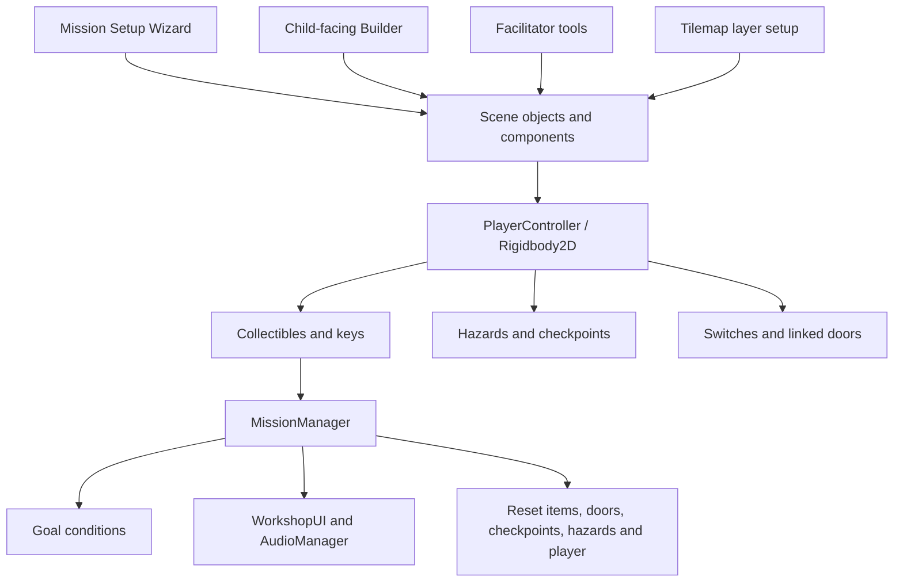

# Architecture

`Workshop.Runtime` contains scene components and ScriptableObject types. `Workshop.Editor` references it and adds the authoring windows. Editor code is excluded from player builds through its assembly definition. EditMode and PlayMode tests have separate test assemblies.

Mission state is scene-local. Managers and the player expose singleton references for this deliberately small one-player workflow. Collectibles register through scene discovery at mission startup. The manager tracks collected instances in a set, rejects duplicate submissions and sums positive item values for the goal/HUD total. Runtime spawning of new collectibles after initialization is outside the current design.

Keys remain discoverable after their objects are deactivated because key queries use the manager's collected-item set. A full mission reset differs from a hazard respawn: it restores the original spawn point, clears inventory, re-enables pickups, closes switches/doors and resets checkpoints and patrolling hazards. Hazard respawns use the latest checkpoint.

The wizard can start in an empty scene. It supplies a camera, visible neutral sprites, supporting managers and the selected gameplay objects. An optional custom player prefab can supply its own appearance. The original string-based compatibility hooks for `CharacterAppearance` / `PlayerMovement` remain optional and do not import vendor code.

The neutral square is generated by `WorkshopShapes` and stored as an ordinary Sprite asset, so editor-generated scenes serialize a stable asset reference. Runtime arrows, pickup particles, goal feedback, UI and fallback sounds are produced by code.

The public project uses the Built-in Render Pipeline because the retained code uses the built-in sprite shader and has no URP dependency. Original vendor tile palettes, scene art and render-pipeline assets were not needed for this extraction.
